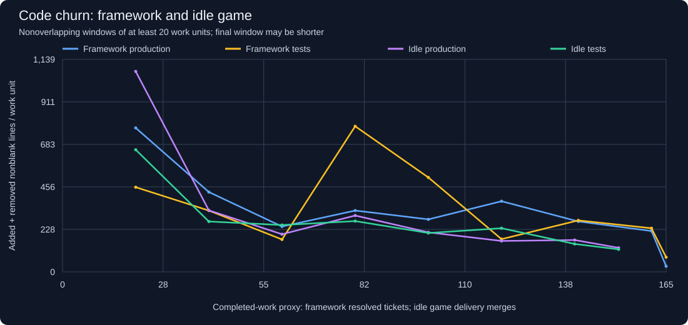
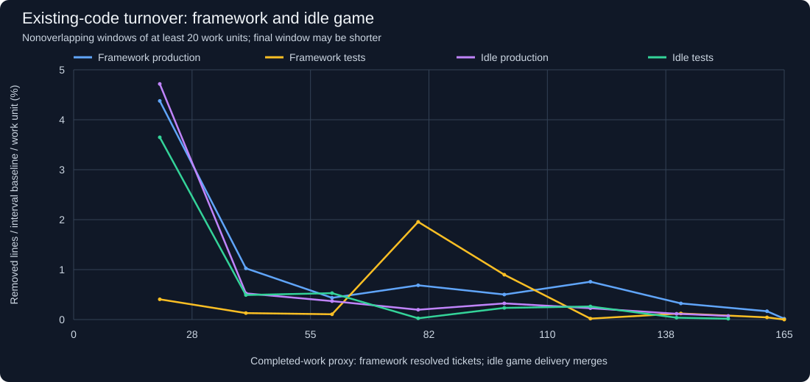
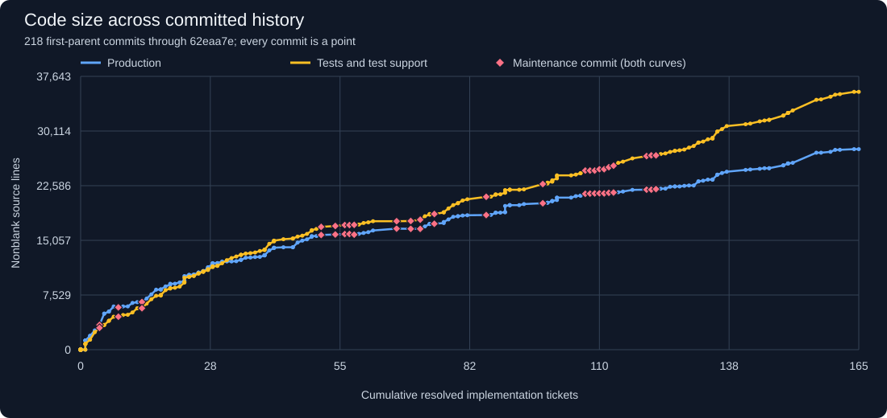
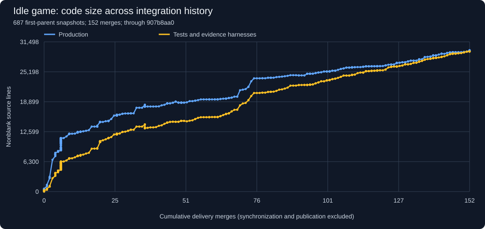
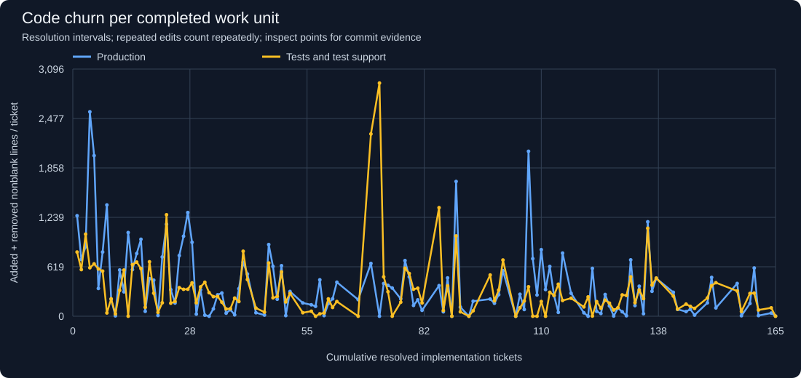
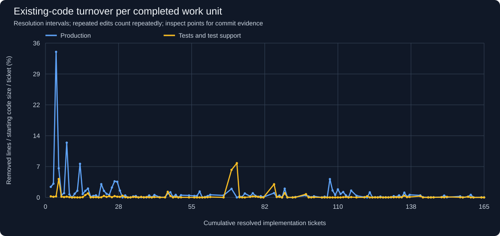
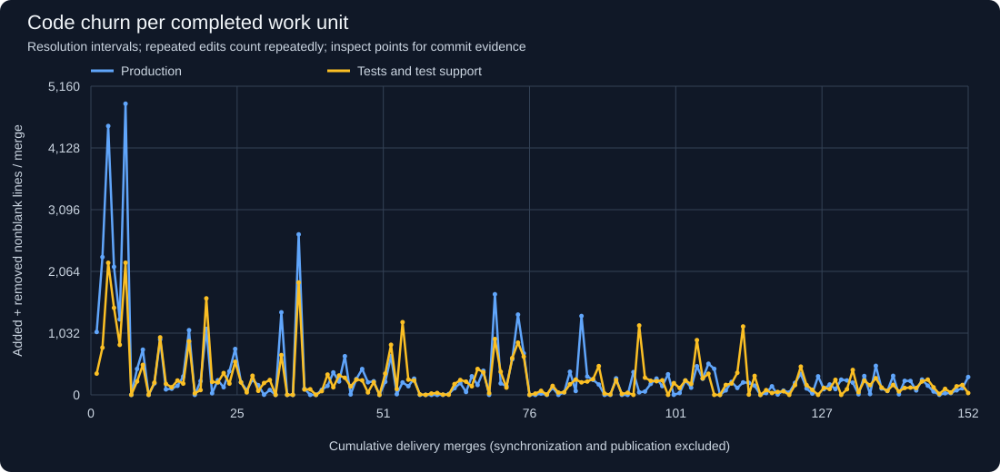
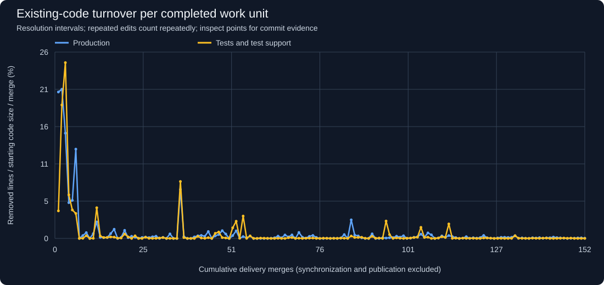

# Framework and idle game: code growth and change stability

Local committed snapshots, generated on 2026-10-27. No network fetch was performed.
Working-tree and staged changes are excluded. These are delivered mainline changes,
not a measure of all editing effort or a rating of architectural quality.

| Endpoint metric | Agent Coordination Framework | Idle game |
| --- | ---: | ---: |
| Commit | `62eaa7e7` | `907b8aa0` |
| Date | 2026-10-25 | 2026-10-27 |
| First-parent snapshots | 218 | 687 |
| Completed-work proxy | 165 resolved implementation tickets | 152 delivery merges |
| Production nonblank lines | 27,616 | 29,715 |
| Test/support nonblank lines | 35,512 | 29,464 |

## Change volume over the course of each project



**Churn is added + removed nonblank lines.** Replacing 100 lines and adding
30 new lines gives 230 churn, versus 30 net growth. Blue/yellow show framework
production/tests; purple/green show idle production/tests. Each point summarizes
at least 20 completions, except the final partial window. Counts differ because
units are indivisible: a framework commit can resolve several tickets together.
See the raw per-interval charts below for spikes hidden by the broad averages.



**Turnover is removed nonblank lines / code size before the interval / work units.**
It isolates changes to established code from pure growth. A one-time full replacement
is about 100%; repeated edits can exceed 100%. The broad-window turnover is the
completion-weighted mean of interval turnover, omitting zero-baseline intervals.
This is a volume measure, not a count of unique original lines or proof of quality.

| Project | Completion range | Units | Production churn / unit | Test churn / unit | Production turnover / unit |
| --- | ---: | ---: | ---: | ---: | ---: |
| Framework | 0–20 | 20 | 771.8 | 453.8 | 4.058% |
| Framework | 20–40 | 20 | 427.9 | 328.6 | 0.950% |
| Framework | 40–60 | 20 | 243.1 | 173.7 | 0.404% |
| Framework | 60–80 | 20 | 328.8 | 780.6 | 0.636% |
| Framework | 80–100 | 20 | 281.4 | 506.2 | 0.465% |
| Framework | 100–120 | 20 | 378.7 | 175.6 | 0.702% |
| Framework | 120–141 | 21 | 270.3 | 276.0 | 0.300% |
| Framework | 141–161 | 20 | 219.1 | 233.9 | 0.155% |
| Framework | 161–165 | 4 | 30.2 | 78.8 | 0.015% |
| Idle game | 0–20 | 20 | 1,074.7 | 654.7 | 4.373% |
| Idle game | 20–40 | 20 | 329.8 | 270.0 | 0.486% |
| Idle game | 40–60 | 20 | 201.8 | 251.1 | 0.342% |
| Idle game | 60–80 | 20 | 302.1 | 272.2 | 0.182% |
| Idle game | 80–100 | 20 | 211.9 | 208.3 | 0.300% |
| Idle game | 100–120 | 20 | 165.8 | 234.1 | 0.211% |
| Idle game | 120–140 | 20 | 170.7 | 149.7 | 0.107% |
| Idle game | 140–152 | 12 | 128.9 | 120.7 | 0.067% |

## Total retained code

### Framework



### Idle game



## Individual completion intervals

### Framework




### Idle game




## Interpretation and comparison limits

Both projects' broad-window production turnover falls substantially after early
build-out. Recent delivered changes are more local relative to codebase size.
There is no sustained rise in the churn windows at the end of either history.
This evidence does not support calling the idle game structurally worse on this
metric alone; large individual changes still deserve inspection in the interval data.

- The framework keeps its [existing tracker-based counting rules](project-growth.md).
  A single resolution commit can cover several tickets, and bookkeeping delays
  mean intervals cannot be assigned precisely to individual tickets.
- The idle game uses `integration/T-0002-idle-game`, fixed at
  `907b8aa07f1fc65c1cc1c8dd7b1e38b912604559`. Its checked-out `main` stops on October 12 and
  local `origin/main` on October 17; neither represents the recent integration work.
  Only commits reachable from the chosen snapshot are included.
- Idle completion proxies are first-parent merges, excluding explicit merges into
  feature/task/docs branches (synchronization) and publication feedback merges.
  The [included merges](project-growth/idle-game/merges.json) and
  [excluded merges](project-growth/idle-game/excluded-merges.json) are auditable.
  These are **merge events, not a verified count of distinct completed tickets**;
  bundled work, follow-ups, documentation and art-only deliveries can distort them.
- Both projects sum diffs between adjacent first-parent snapshots, with rename
  detection. Idle branch-internal edits that cancel before integration are invisible.
  Framework work committed directly to main exposes more intermediate edits.
  Therefore compare trends within each project more strongly than absolute levels
  between projects. Neither chart measures total agent effort or retries.
- Intervals run between the last snapshots at adjacent completion counts, matching
  the original framework analysis. Intervening fixes are included. Initial work
  before the last zero-count snapshot is excluded from per-completion charts,
  but retained in history.csv. Trailing work belongs to the last interval.
- Lines are nonblank physical source lines including comments, using the same
  extension set as the original report. Documentation, binaries, dependency files,
  configuration and data such as progression JSON are excluded. Asset changes
  therefore contribute no source churn even when they materially change the game.
- Idle tests include `src/Tests`, projects whose directory ends in `Checks`, and
  source filenames containing `Evidence` or `Verification`, including embedded
  native verification harnesses. `PhysicsSpike` files are prototype code.
  Remaining source under `src/` is production. This explicit heuristic is recorded
  [per file](project-growth/idle-game/classification.json); compilation into an app
  does not make evidence harnesses player-facing production code.
- Formatting, extraction, deletion and intentional redesign all create churn.
  Ticket size, complexity, defect rate and test quality are not controlled for.
  Pair outliers with review/defect evidence before making design judgments.

## Evidence and reproduction

- [Framework per-commit history](project-growth/history.csv) and
  [completion intervals](project-growth/churn-intervals.json).
- [Idle per-commit history](project-growth/idle-game/history.csv),
  [completion intervals](project-growth/idle-game/churn-intervals.json), and
  [snapshot metadata](project-growth/idle-game/snapshot.json).
- [Framework window data](project-growth/window-churn-intervals.json) and
  [idle window data](project-growth/idle-game/window-churn-intervals.json).

From the framework repository, without staging or checking out historical trees:

```powershell
python docs/project-growth/generate.py --ref 62eaa7e7da8bc35fa62362acea07554ba0d6e70e
python docs/project-growth/compare_idle.py --repo ../idle-games --ref 907b8aa07f1fc65c1cc1c8dd7b1e38b912604559
```

Use `--ref HEAD` on the framework and `--ref integration/T-0002-idle-game` on
the idle game for a later local snapshot. Rerun both in that order. The scripts
check that additions minus removals equals the measured size change for both
source categories at every snapshot. All 201 original framework size/ticket
snapshots were also checked against the prior report and preserved exactly.
